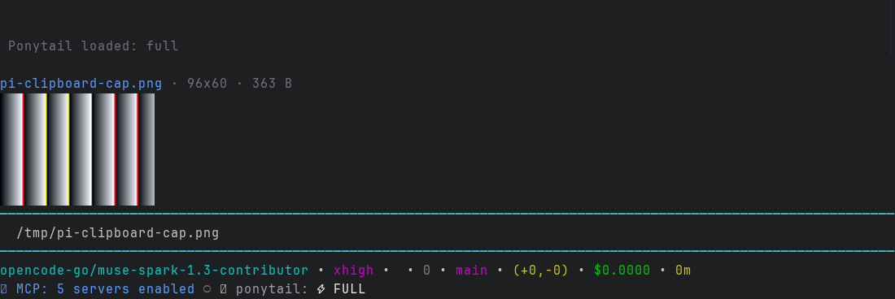
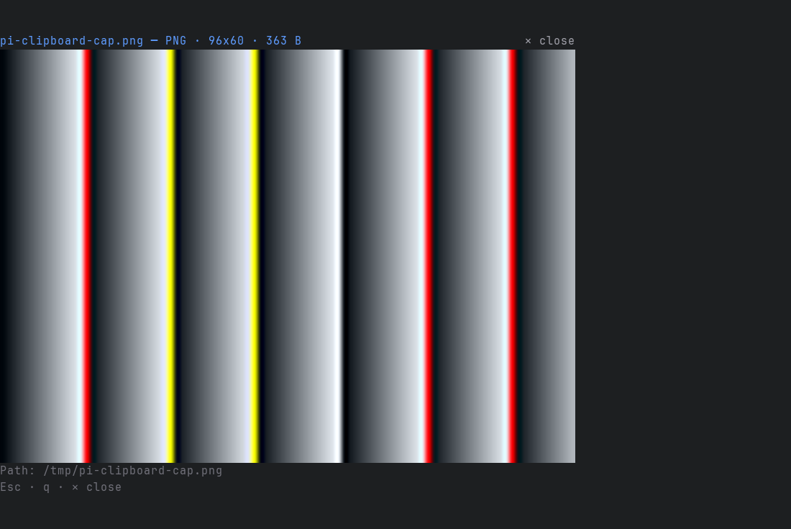
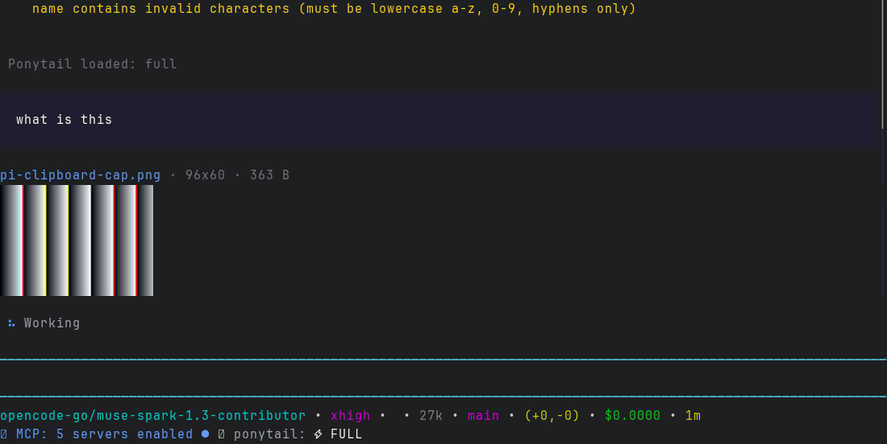

# pi-peek

See pasted images right above your [pi](https://github.com/earendil-works/pi) prompt. Thumbnails appear the moment an image is referenced, and the model receives the pixels.



## Features

- **Instant thumbnails.** Paste a screenshot and a thumbnail band appears above the editor with a clickable label per image.
- **Compact with many images.** One row of labels plus one thumbnail, so ten images cost seven rows instead of ten stacked pictures.
- **Fullscreen view.** Click a thumbnail for a near-fullscreen look with format, dimensions, size, and path. Dismiss with `Esc`, `q`, `Enter`, the close control, or a click outside the image.
- **Editor tokens.** Pasted images show as `[Image #1]`, `[Image #2]`, and so on instead of a temp path. Click a token to open it.
- **Real attachments on send.** Pasted images become message attachments, their tokens leave the text, and the transcript keeps a compact filmstrip.





## Install

pi-peek is a standard [pi package](https://github.com/earendil-works/pi/blob/main/packages/coding-agent/docs/packages.md). One command installs it:

```sh
pi install git:github.com/SachinD6/pi-peek
```

Then restart pi. Update and removal follow the same standard commands:

```sh
pi update git:github.com/SachinD6/pi-peek
pi remove git:github.com/SachinD6/pi-peek
```

Hacking on the extension itself? Clone the repo and link the extension directory so edits take effect on restart:

```sh
git clone https://github.com/SachinD6/pi-peek
ln -sfn "$PWD/pi-peek/extensions/image-preview" ~/.pi/agent/extensions/image-preview
```

## Usage

1. Paste or drop an image into the prompt. A token like `[Image #1]` lands in the editor and the thumbnail band appears above it.
2. Click a label to switch images, click the thumbnail for the fullscreen view. The band hides two seconds after a paste; the one-line chip above the prompt brings it back.
3. Send. The images ride along as attachments and the transcript shows the filmstrip.

Typed, `@`-completed, and dropped image paths preview too. Limits: ten images per prompt, and images smaller than 8 px on a side are skipped. Terminals without Kitty or iTerm2 graphics get a caption plus a text line instead of pixels.

## Development

```sh
node --test extensions/image-preview/image-preview.test.ts  # pure helper tests
python3 verify-tui.py                                        # end-to-end checks in a real pi TUI
python3 docs/capture.py                                      # regenerate the README screenshots
```

`verify-tui.py` drives a real pi session in a pty and asserts the band, overlay, attachment, and no-graphics fallback. `docs/capture.py` renders the same live session to the PNGs shown above. Design notes and tradeoffs live in `DESIGN.md`.

```
pi-peek/
├── package.json                       # pi-package manifest
├── extensions/image-preview/
│   ├── index.ts                       # extension entry (band, overlay, send hook)
│   ├── image-preview-lib.ts           # pure helpers (no pi imports)
│   └── image-preview.test.ts          # unit tests
├── docs/                              # screenshots + capture script
├── verify-tui.py                      # end-to-end TUI harness
└── DESIGN.md                          # design, constraints, verification notes
```

## License

MIT. See [LICENSE](LICENSE).
